# Topaz Jewelry: Architecture (Phase 1)

Status: **draft for approval**. No code exists yet. Language of this document: English. UI language: Russian. Currency: KZT.

## 0. Summary of decisions and stack challenges

The proposed stack is accepted. Real problems and adjustments:

| # | Topic | Decision | Why |
|---|-------|----------|-----|
| 1 | Two runtimes (Next + FastAPI) | Keep, but serve both **same-origin** behind one reverse proxy (`/` -> Next, `/api/*` -> FastAPI) | Cookies, CSRF and CORS become trivial. Without this, cross-site cookies are the most common source of auth bugs in this split. |
| 2 | JWT vs sessions | **Server-side sessions** in PostgreSQL, opaque token in an httpOnly cookie | One browser app, same origin. Sessions are revocable and simpler than JWT + refresh. JWT gives nothing here. |
| 3 | Queue | **arq + Redis** | Redis is needed anyway (rate limiting, short caches). arq is small, async-native, matches FastAPI. Alternative (Postgres-based queue such as procrastinate) saves one container but adds less-known tooling. Pick arq. |
| 4 | Reverse proxy | **Caddy** instead of nginx | Automatic TLS, 10-line config. Fewer ways to break on a solo-run VPS. |
| 5 | Image resizing | **Resize at upload time** (Pillow, fixed widths, WebP + AVIF), serve files straight from S3/MinIO via Caddy or CDN. Next `<Image>` uses a custom loader that picks a pre-generated variant | Avoids running the Next image optimizer on a small VPS and keeps CPU spikes out of page requests. |
| 6 | Admin in Next.js | Keep, as a protected `/admin` route group, client-rendered, generic CRUD components | One deploy, shared types. Admin does not need SSR or SEO. |
| 7 | Attributes | **Typed columns and join tables**, not EAV | Jewelry filters are a fixed, small set (category, metal, purity, stone, price, availability). Typed columns are indexable, simple and fast. A new attribute is a migration, which is acceptable. |
| 8 | Data residency | **Open question (section 12)** | Kazakhstan law requires personal data of citizens to be stored on servers located in Kazakhstan. This affects VPS choice. |
| 9 | Fiscal receipts | Placeholder hook only | Kazakhstan requires online cash registers (OFD). Depends on the acquirer and client. Not in MVP. |

Principles: modular monolith, one deployable backend, explicit module boundaries, provider interfaces only at real external seams (payments, email, storage), everything else concrete.

---

## 1. Repository layout and backend modules

```
topaz-jewelry/
├─ apps/
│  ├─ web/                      # Next.js (App Router), TypeScript, Tailwind, shadcn/ui
│  │  ├─ src/app/
│  │  │  ├─ (shop)/             # public: catalog, product, cart, checkout, stores, info pages
│  │  │  ├─ (account)/          # profile, orders, favorites (only when ACCOUNTS enabled)
│  │  │  ├─ admin/              # protected admin area
│  │  │  ├─ sitemap.ts, robots.ts
│  │  ├─ src/components/        # ui/ (shadcn), shop/, admin/, bot/
│  │  ├─ src/lib/api/           # generated client + thin wrappers (SSR and browser)
│  │  ├─ src/lib/features.ts    # feature-flag access
│  │  └─ src/content/ru.ts      # ALL user-facing Russian strings (single place)
│  └─ api/                      # FastAPI
│     ├─ app/
│     │  ├─ main.py, config.py, deps.py, errors.py, logging.py
│     │  ├─ core/               # db session, security, rate limit, pagination, money, storage, features
│     │  ├─ modules/
│     │  │  ├─ catalog/         # categories, products, variants, stones, images, store locations (read side)
│     │  │  ├─ orders/          # carts, checkout, orders, stock reservation
│     │  │  ├─ payments/        # provider interface, providers/, webhooks, state machine
│     │  │  ├─ auth/            # users, sessions, addresses, favorites, profile
│     │  │  ├─ newsletter/      # subscribers, campaigns, email provider interface
│     │  │  ├─ support_bot/     # Q&A tree
│     │  │  ├─ notifications/   # email templates and sending; queue tasks
│     │  │  ├─ content/         # banners, info pages, contacts, store locations, site settings
│     │  │  └─ admin/           # admin-only routers composing the modules' services
│     │  ├─ worker.py           # arq worker entrypoint
│     │  └─ migrations/         # Alembic
│     ├─ tests/
│     └─ pyproject.toml
├─ packages/
│  └─ api-client/               # generated TS client from OpenAPI (committed)
├─ infra/
│  ├─ docker-compose.yml, docker-compose.prod.yml
│  ├─ caddy/Caddyfile
│  └─ scripts/                  # backup, restore, deploy
├─ e2e/                         # Playwright
├─ .github/workflows/ci.yml
├─ .env.example
├─ ARCHITECTURE.md, CLAUDE.md, README.md
└─ package.json / pnpm-workspace.yaml
```

Tooling: pnpm workspaces for JS, `uv` for Python. Makefile or `just` for common commands.

### Backend module rules

Each module in `modules/<name>/` has the same shape: `models.py` (SQLAlchemy), `schemas.py` (Pydantic), `service.py` (business logic), `router.py` (HTTP, public), `repo.py` (queries, only if non-trivial), `tasks.py` (arq jobs, if any).

- Routers call services. Services own transactions and business rules. Routers contain no business logic.
- A module may import another module's **service** or **schemas**, never its models or repo. Allowed dependency direction: `admin` -> everything; `orders` -> `catalog`, `payments`, `notifications`, `auth`; `payments` -> `orders` (via narrow interface, see section 5); `notifications` -> nothing; `catalog`, `content`, `support_bot`, `newsletter` -> `notifications` only where needed.
- Cross-module reactions go through **domain events** in-process (a tiny `emit(OrderPaid)` that enqueues arq jobs). This keeps `payments` from importing email code.
- Admin endpoints live under `modules/admin/` and reuse services. They are not duplicated business logic.
- Import boundaries are enforced in CI with `import-linter`.

---

## 2. Database schema

PostgreSQL 16. Primary keys: `bigint` identity for internal tables, plus a public `uuid` (or human number) where exposed. Timestamps `timestamptz`, UTC. Money: `bigint` in minor units (1 KZT = 100 tiyn), column suffix `_minor`. Soft delete only where noted (`is_active` / `deleted_at`).

```mermaid
erDiagram
    users ||--o{ addresses : has
    users ||--o{ sessions : has
    users ||--o{ favorites : has
    users ||--o{ orders : places
    users ||--o| carts : owns
    categories ||--o{ categories : parent
    categories ||--o{ products : contains
    products ||--|{ product_variants : has
    products ||--o{ product_images : has
    products ||--o{ product_stones : has
    stones ||--o{ product_stones : used_in
    products ||--o{ favorites : favorited
    carts ||--o{ cart_items : has
    product_variants ||--o{ cart_items : in
    orders ||--|{ order_items : has
    product_variants ||--o{ order_items : snapshot_of
    orders ||--o{ payments : paid_by
    payments ||--o{ payment_events : receives
    orders ||--o{ order_status_history : logs
    store_locations ||--o{ orders : pickup_at
    bot_nodes ||--o{ bot_nodes : parent
    subscribers ||--o{ newsletter_sends : receives
    newsletter_campaigns ||--o{ newsletter_sends : produces

    users {
        bigint id PK
        uuid public_id UK
        citext email UK
        text password_hash
        text role "customer|admin"
        text first_name
        text last_name
        text phone
        bool is_active
        timestamptz email_verified_at
        timestamptz created_at
    }
    sessions {
        bigint id PK
        bigint user_id FK
        text token_hash UK
        text csrf_token
        timestamptz expires_at
        timestamptz last_seen_at
        text ip
        text user_agent
    }
    addresses {
        bigint id PK
        bigint user_id FK
        text label
        text city
        text street
        text house
        text apartment
        text postal_code
        bool is_default
    }
    categories {
        bigint id PK
        bigint parent_id FK
        text slug UK
        text name
        text description
        int sort_order
        bool is_active
        text seo_title
        text seo_description
    }
    products {
        bigint id PK
        text slug UK
        bigint category_id FK
        text name
        text description
        text metal "gold|silver|platinum"
        text gold_color "yellow|white|rose"
        int purity "585|750|925..."
        numeric weight_g
        text sku_base
        bool is_active
        timestamptz published_at
        timestamptz created_at
    }
    product_variants {
        bigint id PK
        bigint product_id FK
        text sku UK
        text size "ring size or length"
        numeric weight_g
        bigint price_minor
        bigint old_price_minor
        int stock_qty
        int reserved_qty
        bool is_active
    }
    product_images {
        bigint id PK
        bigint product_id FK
        text storage_key
        text alt
        int width
        int height
        int sort_order
        bool is_primary
    }
    stones {
        bigint id PK
        text slug UK
        text name "diamond, topaz..."
    }
    product_stones {
        bigint product_id FK
        bigint stone_id FK
        int count
        numeric carat
    }
    favorites {
        bigint user_id FK
        bigint product_id FK
        timestamptz created_at
    }
    carts {
        bigint id PK
        uuid token UK "guest cookie"
        bigint user_id FK "nullable"
        timestamptz updated_at
    }
    cart_items {
        bigint id PK
        bigint cart_id FK
        bigint variant_id FK
        int qty
    }
    orders {
        bigint id PK
        text number UK "TZ-2026-000123"
        bigint user_id FK "nullable"
        text status
        text mode "paid|request"
        text customer_name
        text customer_phone
        text customer_email
        text delivery_method "pickup|courier|post"
        bigint pickup_store_id FK
        jsonb shipping_address
        text comment
        bigint subtotal_minor
        bigint delivery_minor
        bigint total_minor
        text currency "KZT"
        timestamptz expires_at
        timestamptz created_at
    }
    order_items {
        bigint id PK
        bigint order_id FK
        bigint variant_id FK
        text name_snapshot
        text sku_snapshot
        text size_snapshot
        bigint unit_price_minor
        int qty
    }
    order_status_history {
        bigint id PK
        bigint order_id FK
        text from_status
        text to_status
        bigint actor_user_id
        text note
        timestamptz created_at
    }
    payments {
        bigint id PK
        bigint order_id FK
        text provider "mock|halyk|tiptop"
        text status
        bigint amount_minor
        text currency
        text provider_payment_id
        text idempotency_key UK
        text failure_reason
        timestamptz created_at
    }
    payment_events {
        bigint id PK
        bigint payment_id FK
        text provider
        text provider_event_id
        jsonb payload
        bool signature_valid
        timestamptz processed_at
    }
    subscribers {
        bigint id PK
        citext email UK
        text status "pending|confirmed|unsubscribed"
        text confirm_token_hash
        text unsubscribe_token UK
        timestamptz consent_at
        text consent_ip
        text consent_text_version
        text source
        timestamptz confirmed_at
        timestamptz unsubscribed_at
    }
    newsletter_campaigns {
        bigint id PK
        text subject
        text body_html
        text status "draft|sending|sent"
        timestamptz sent_at
    }
    newsletter_sends {
        bigint id PK
        bigint campaign_id FK
        bigint subscriber_id FK
        text status
        timestamptz sent_at
    }
    bot_nodes {
        bigint id PK
        bigint parent_id FK
        text kind "menu|answer|link|handoff"
        text label
        text answer_text
        text link_url
        int sort_order
        bool is_active
    }
    banners {
        bigint id PK
        text title
        text subtitle
        text image_key
        text link_url
        text placement "home_hero|home_strip"
        int sort_order
        timestamptz starts_at
        timestamptz ends_at
        bool is_active
    }
    store_locations {
        bigint id PK
        text slug UK
        text city "Astana|Karaganda"
        text name
        text address
        numeric lat
        numeric lng
        text phone
        jsonb opening_hours
        text image_key
        bool is_active
    }
```



Also (not drawn): `pages` (slug, title, body_md, for about / delivery / contacts), `site_settings` (key/value: contacts, WhatsApp number, social links, SEO defaults), `email_outbox` (optional log of sent mail), `audit_log` (admin actions: who, what, entity, before/after JSON).

### Key indexes and constraints

- `products`: `(is_active, category_id, published_at DESC)`, `(metal, purity)`, GIN trigram on `name` for search, unique `slug`.
- `product_variants`: unique `sku`, index `(product_id)`, partial index `(product_id) WHERE stock_qty - reserved_qty > 0` for availability filter. Check `reserved_qty >= 0 AND reserved_qty <= stock_qty`.
- `product_stones`: PK `(product_id, stone_id)`; index `(stone_id)`.
- `favorites`: PK `(user_id, product_id)`.
- `cart_items`: unique `(cart_id, variant_id)`.
- `orders`: unique `number`; indexes `(user_id, created_at DESC)`, `(status, created_at)`, `(customer_email)`.
- `payments`: unique `idempotency_key`; index `(order_id)`; unique `(provider, provider_payment_id)`.
- `payment_events`: **unique `(provider, provider_event_id)`**, the idempotency guard for webhooks.
- `subscribers`: unique `email` (citext).
- `bot_nodes`: index `(parent_id, sort_order)`.
- `sessions`: unique `token_hash`, index `(user_id)`, index `(expires_at)` for cleanup.

### Design notes

- **Variants and limited pieces.** `product_variants` carries size, price and stock. One-of-a-kind pieces are a single variant with `stock_qty = 1`. Price is per variant because weight changes with size. Whether the client prices by weight x gold rate is an open question; the MVP stores a fixed price.
- **Price display filter** uses `MIN(price_minor)` over active variants (denormalize to `products.price_from_minor` via a trigger or service-side update if the query gets slow).
- **Order items are snapshots** (name, SKU, size, price). Catalog edits never rewrite history.
- **Stock reservation.** On checkout, `reserved_qty` is incremented inside one transaction using `UPDATE ... WHERE stock_qty - reserved_qty >= :qty` (atomic, no oversell). On payment success or request confirmation, `stock_qty` is decremented and `reserved_qty` released. On cancel or expiry (`orders.expires_at`, default 30 min for unpaid online orders), the reservation is released by an arq cron job.
- **Guest checkout** works through nullable `orders.user_id` and contact fields stored on the order. Guest order lookup uses a signed link in the confirmation email.
- **Search** in MVP: Postgres `pg_trgm` + `ILIKE`. No Elasticsearch.

---

## 3. REST API outline

Base path `/api/v1`. JSON. OpenAPI auto-generated by FastAPI is the source of truth; the TS client is generated from it (`openapi-typescript` + `openapi-fetch`) and committed.

### Conventions

- **Pagination:** `?page=1&page_size=24` (max 100). Response `{ items: [...], total, page, page_size }`. Offset pagination is enough at this scale.
- **Sorting:** `?sort=price_asc|price_desc|newest|popular`.
- **Filtering:** flat query params, repeatable for multi-select: `?category=rings&metal=gold&purity=585&purity=750&stone=diamond&price_min=50000&price_max=300000&in_stock=true&q=...`. Price params are in **KZT whole units** at the API edge for catalog filtering, and **minor units** in all responses and order/payment objects. (Decision to confirm; alternative is minor everywhere.)
- **Facets:** the list endpoint optionally returns `facets` (counts per metal, purity, stone, price range) with `?include=facets`.
- **Errors:** RFC 7807-style `{ "type", "title", "status", "detail", "code", "errors": [{field, message}] }`. `code` is a stable machine string (`out_of_stock`, `validation_error`...). The frontend maps codes to Russian text in `content/ru.ts`.
- **Money:** always `{ "amount_minor": 12345000, "currency": "KZT" }` or field suffix `_minor`.
- **IDs:** public routes use `slug` (catalog) or `number`/`public_id` (orders, users). No sequential internal IDs exposed.
- **Idempotency:** `Idempotency-Key` header on `POST /checkout`.

### Endpoints

Auth column: **P** public, **S** session optional, **U** logged-in customer, **A** admin.

| Area | Endpoint | Auth | Notes |
|------|----------|------|-------|
| System | `GET /health` | P | liveness + DB/Redis check |
| | `GET /config` | P | public feature flags and site constants (see section 6) |
| Catalog | `GET /categories` | P | tree |
| | `GET /products` | P | filters, sort, pagination, facets |
| | `GET /products/{slug}` | P | variants, images, stones |
| | `GET /products/{slug}/related` | P | |
| | `GET /search/suggest?q=` | P | |
| Content | `GET /banners?placement=` | P | |
| | `GET /stores`, `GET /stores/{slug}` | P | |
| | `GET /pages/{slug}` | P | about, delivery, contacts |
| | `GET /settings/public` | P | contacts, WhatsApp number |
| Cart | `GET /cart`, `PUT /cart/items/{variant_id}`, `DELETE /cart/items/{variant_id}` | S | cart token cookie for guests |
| Checkout | `POST /checkout` | S | creates order (+ payment if payments on). Returns `{order, payment?: {redirect_url}}` |
| Orders | `GET /orders/{number}?t=<signed>` | P/U | guest via signed token |
| | `GET /me/orders`, `GET /me/orders/{number}` | U | accounts on |
| Payments | `GET /payments/{id}/status` | S | poll after return; truth comes from the DB |
| | `POST /webhooks/payments/{provider}` | P (signature) | never trust browser redirect |
| Auth | `POST /auth/register`, `/auth/login`, `/auth/logout`, `/auth/password/forgot`, `/auth/password/reset`, `/auth/verify-email` | P/U | accounts on, except admin login |
| | `GET /auth/csrf` | S | returns/refreshes CSRF token |
| Profile | `GET/PATCH /me`, `CRUD /me/addresses`, `GET/PUT/DELETE /me/favorites/{product_id}` | U | accounts on |
| Newsletter | `POST /newsletter/subscribe`, `GET /newsletter/confirm?token=`, `GET/POST /newsletter/unsubscribe?token=` | P | |
| Bot | `GET /support-bot/tree` | P | whole active tree in one cacheable payload |
| Admin | `/admin/{products,variants,categories,stones,images,orders,users,subscribers,newsletters,bot-nodes,banners,stores,pages,settings}` | A | generic list/get/create/update/delete; `POST /admin/orders/{id}/transition`; `POST /admin/products/{id}/images` (upload); `POST /admin/newsletters/{id}/send` |

Admin list endpoints share one convention (`page`, `page_size`, `sort`, `q`, per-resource filters) so the frontend generic table works for all.

---

## 4. Auth design

**Mechanism:** server-side sessions.

- Login: verify email + password (**argon2id** via `argon2-cffi`), create a `sessions` row with random 256-bit token; store only its SHA-256 hash. Cookie `topaz_session`: `HttpOnly; Secure; SameSite=Lax; Path=/`, 30 days sliding for customers, **8 hours** for admins.
- Because the site is same-origin, Next.js server components forward the incoming cookie to FastAPI when fetching user-specific data. Public catalog fetches carry no cookie, so they stay cacheable.
- **CSRF:** `SameSite=Lax` plus a **double-submit/synchronizer token**. A non-HttpOnly `topaz_csrf` cookie (or `GET /auth/csrf`) is echoed in an `X-CSRF-Token` header on every `POST/PUT/PATCH/DELETE`. Backend rejects mismatches. `Origin` header is also checked against the allowed host. Webhooks are exempt (signature auth instead).
- **Rate limiting** (Redis, sliding window; `slowapi` or a small custom dependency): login 5/min per IP+email, register 5/hour per IP, password reset 3/hour per email, newsletter subscribe 5/hour per IP, checkout 10/hour per IP. Account lockout is avoided (it enables DoS); use exponential delay instead.
- **Roles:** `customer`, `admin`. Dependency `require_admin` guards `/admin/*`. Admin accounts are created via CLI command (`python -m app.cli create-admin`), never through public registration. A future `manager` role is a one-line enum addition.
- **Password reset / email verification:** single-use, hashed, expiring tokens (1 h), sent through the queue.
- **Important:** the `users` table and admin login exist **even when ACCOUNTS is off**. The flag only disables customer registration, login UI, profile, favorites and order history.
- Password policy: min 10 chars, check against a small breached-password list later. No composition rules.
- Session cleanup: arq cron deletes expired sessions daily.

---

## 5. Payment design

### Provider interface (`modules/payments/providers/base.py`)

```python
class PaymentProvider(Protocol):
    name: str
    def create_payment(self, req: CreatePaymentRequest) -> CreatePaymentResult: ...
        # in: order number, amount_minor, currency, return URLs, idempotency_key, customer email
        # out: provider_payment_id, redirect_url (or client params), initial status
    def parse_webhook(self, headers: Mapping, raw_body: bytes) -> WebhookEvent: ...
        # verifies signature, raises InvalidSignature; returns normalized event
        # (provider_event_id, provider_payment_id, status, amount_minor, raw)
    def get_status(self, provider_payment_id: str) -> ProviderStatus: ...
        # server-to-server reconciliation
    def refund(self, provider_payment_id: str, amount_minor: int) -> RefundResult: ...
```

Providers register in a registry chosen by `PAYMENT_PROVIDER` env. The **mock provider** serves a fake hosted payment page (a Next.js route `/mock-pay/[id]` with "Success / Fail / Cancel" buttons) that triggers a **signed webhook** to our own endpoint, so the whole real flow, including signature verification and idempotency, is exercised from day one. Real providers (Halyk Epay, TipTopPay) are one new file each implementing the interface.

### State machines

Payment: `created -> pending -> succeeded | failed | cancelled`; `succeeded -> refunded | partially_refunded`. Transitions are validated by one function; illegal transitions are logged and ignored (webhooks can arrive out of order or twice).

Order (mode `paid`):
`new -> awaiting_payment -> paid -> processing -> ready_for_pickup | shipped -> completed`
Side exits: `awaiting_payment -> expired`, any pre-shipped state `-> cancelled`, `paid -> refunded`.

Order (mode `request`, payments off):
`new -> confirmed (manager called client) -> processing -> ready_for_pickup | shipped -> completed`, or `-> cancelled`. The same status enum, with `awaiting_payment`/`paid` simply unused. Every transition writes `order_status_history` and emits a domain event (email to client, email/Telegram-less admin notification).

### Webhook handling

1. `POST /webhooks/payments/{provider}` reads the **raw body** (needed for HMAC).
2. `provider.parse_webhook` verifies the signature. Invalid -> 400, store the event with `signature_valid=false` for diagnostics, do nothing else.
3. Insert into `payment_events` with unique `(provider, provider_event_id)`. On conflict -> return 200 immediately (idempotent replay).
4. Enqueue an arq job `process_payment_event(event_id)` and return 200 fast.
5. Worker: lock payment row (`SELECT ... FOR UPDATE`), verify `amount_minor` and currency match the order, apply the state transition, then order transition, in one transaction. Mismatch -> mark `failed` + alert in logs.
6. **The browser return URL never changes state.** It only shows a "checking payment" page that polls `GET /payments/{id}/status` (which may call `provider.get_status` once as reconciliation).
7. An arq cron reconciles payments stuck in `pending` for more than 15 minutes via `get_status`, and expires unpaid orders.

### Other rules

- Amounts: `bigint` minor units everywhere; conversion to the provider's format happens only inside provider adapters.
- Totals are computed server-side from DB prices at checkout. Client-sent prices are ignored.
- **Fiscalization hook:** `payments/fiscal.py` defines `FiscalReceiptHook.on_payment_succeeded(order, payment)`; default is a no-op that logs. Real implementation (OFD / cash-register integration, depends on acquirer) plugs in later without touching business logic.
- Card data never touches our servers (hosted payment page or provider widget).

---

## 6. Feature flags

Two flags for MVP: `FEATURE_ACCOUNTS`, `FEATURE_PAYMENTS` (env vars, boolean). Flags are read **at runtime**, not baked into the frontend build, so toggling needs a container restart but not a rebuild.

**Backend:** `core/features.py` exposes `features.accounts` / `features.payments`. A dependency `require_feature("accounts")` returns `404` for disabled routers (customer register/login, `/me/*`). Checkout service branches on `features.payments` to choose order `mode`. Admin endpoints are never feature-gated except the payments views.

**Frontend:** `GET /api/v1/config` returns `{ features: { accounts, payments }, whatsapp, ... }`. The root server layout fetches it (short revalidate, e.g. 60 s), and passes it down via a context provider; `lib/features.ts` offers `getFeatures()` for server components. UI items (login icon, favorites heart, profile menu, pay button) render from it. Disabled routes (`/account/*`) call `notFound()`.

| | Accounts OFF | Accounts ON |
|---|---|---|
| Header | no login/profile icons | login/profile icon |
| Favorites | hidden (optional: local-only wishlist later) | heart button, synced |
| Checkout | guest only: name, phone, email, delivery | guest **or** logged-in; prefilled; save address |
| After order | email with signed order link | plus order history in profile |
| Cart | guest cart (cookie token) | guest cart merged into user cart on login |

| | Payments OFF (request mode) | Payments ON |
|---|---|---|
| Checkout button | "Оформить заявку" | "Оплатить" |
| Flow | order created as `new`, no payment, manager calls the client, email "заявка принята" | order -> `awaiting_payment` -> redirect to provider -> return page polls status |
| Order statuses | request flow (section 5) | paid flow |
| Stock | reserved until the manager confirms or cancels (no auto-expiry; configurable) | reserved with expiry |

Flags must be tested in CI in all four combinations for the checkout path (backend integration tests parametrized; one Playwright flow per mode, at minimum guest + request mode and guest + mock payment).

---

## 7. Newsletter

- **Subscribe:** `POST /newsletter/subscribe {email, consent: true}` creates/updates a `subscribers` row with `status=pending`, stores `consent_at`, IP, and `consent_text_version` (the exact consent wording is versioned in `content/ru.ts`). A confirmation email with a random token (hash stored) is queued. Always responds with the same message to avoid email enumeration.
- **Confirm:** `GET /newsletter/confirm?token=` sets `confirmed`, `confirmed_at`. Tokens expire after 48 h.
- **Unsubscribe:** every email contains a per-subscriber permanent `unsubscribe_token` link (`/newsletter/unsubscribe?token=`), plus the `List-Unsubscribe` and `List-Unsubscribe-Post` headers for one-click. Unsubscribe is a one-step confirm page and writes `unsubscribed_at`. Re-subscribing requires a fresh double opt-in.
- **Campaigns:** admin creates a campaign (subject, HTML body from a simple template with a fixed layout), sends a test, then "send". An arq job fans out `newsletter_sends` rows in batches (rate-limited to the provider's quota) to `confirmed` subscribers only. Per-send status is stored for retries.
- **Provider abstraction:** `EmailProvider.send(message)` with implementations `SmtpProvider` (default; works with any SMTP relay), `ConsoleProvider` (dev, prints to log; MailHog in Docker Compose to view mail), and later e.g. Unisender/Resend/Postmark. Transactional mail (order, reset, confirm) and marketing mail use the same interface with a `stream` hint so they can use different senders or domains later.
- **Deliverability:** SPF, DKIM, DMARC on the sending domain (deploy checklist item).
- **Consent record** is retained even after unsubscribe (legal evidence); full erasure on request deletes the email and keeps an anonymized hash.

---

## 8. Support bot

Button-based, no AI. Content is a tree editable in admin.

**Model:** `bot_nodes(id, parent_id, kind, label, answer_text, link_url, sort_order, is_active)`.
- `menu`: shows children as buttons (root level = children of null).
- `answer`: shows `answer_text` (plain text with limited markdown: bold, links, line breaks), then offers "Назад" and "В начало".
- `link`: opens an internal/external URL (for example delivery page).
- `handoff`: "Связаться с менеджером" -> opens WhatsApp.

**API:** `GET /support-bot/tree` returns the full active tree (a few dozen nodes) in one response, cached (HTTP `Cache-Control: max-age=300` + server revalidate). The widget navigates client-side with no further calls. Admin: CRUD `/admin/bot-nodes`, reorder via `sort_order`, tree view in UI.

**Frontend widget:** floating button bottom-right, lazy-loaded (dynamic import after idle) so it costs nothing on first paint. A panel with a message list; selecting a button appends the user's choice and the bot's answer. State (current node path) kept in component state and `sessionStorage`. A persistent "Написать менеджеру в WhatsApp" button appears on every screen.

**WhatsApp handoff:** link `https://wa.me/<number>?text=<prefilled>`. Number comes from `site_settings` (public settings endpoint). The prefilled text includes the page title/URL and the last bot path (for example "Здравствуйте! Вопрос по доставке. Страница: ..."), URL-encoded. No WhatsApp Business API is needed.

**Analytics (cheap):** optional `POST /support-bot/events` counting node clicks to see which questions matter. Cut first if time is short.

---

## 9. SEO and performance

- **Rendering:** catalog, category, product, store and info pages are server components with ISR via `fetch(..., { next: { revalidate: 300, tags: [...] } })`. Admin changes trigger on-demand revalidation (`POST /api/revalidate` on the Next side, called by the backend with a shared secret after product/category/banner/page updates). Home page: ISR 5 min. Cart, checkout, account, admin: dynamic/client, `noindex`.
- **Catalog filters:** filter state lives in the URL query string; the page is server-rendered from it (shareable and crawlable). Canonical URL for filtered pages points to the unfiltered category except for one or two curated combos (for example `/catalog/rings?metal=gold`). Filtered/paged variants use `noindex,follow` beyond page 1 + a whitelisted set.
- **Metadata:** `generateMetadata` per route (title, description, canonical, OpenGraph with product image). Titles and descriptions come from `seo_title/seo_description` fields with sensible Russian templates as fallback. `<html lang="ru">`.
- **Sitemap and robots:** `app/sitemap.ts` generated from a `GET /sitemap/entries` backend endpoint (categories, products, stores, pages), `robots.ts` excludes `/admin`, `/cart`, `/checkout`, `/account`, `/api`.
- **Structured data (JSON-LD):** `Product` (name, image, description, sku, brand, `offers` with price, `priceCurrency: KZT`, `availability`), `BreadcrumbList`, `Organization` + `LocalBusiness`/`JewelryStore` for each store on the stores page.
- **Images:** on upload, generate widths 320/640/960/1440 (+ one 2000 for zoom) in **WebP and AVIF**, store as `images/{id}/{w}.{ext}`; DB stores `storage_key` base, width/height (prevents layout shift). A custom Next image loader and `<picture>`/`srcset` pick variants. Cache headers `immutable, max-age=1y` (keys include content hash). Primary image of above-the-fold content uses `priority`; the rest lazy. Originals are kept privately for regeneration.
- **Performance budgets:** LCP < 2.5 s on 4G mobile for product/category pages, JS for catalog page < 150 kB gzipped (shadcn components imported individually; bot widget and admin code split out). Fonts via `next/font` with Cyrillic subset.
- **Backend caching:** categories, banners, stores, bot tree: Redis cache with invalidation on admin write. Product list: DB indexes first, cache only if measured necessary.
- **Lighthouse CI** step in GitHub Actions (non-blocking at first).

---

## 10. Security, logging, errors, config, backups, deployment

**Security**
- HTTPS only; HSTS; security headers via Caddy and Next (`Content-Security-Policy` with nonces, `X-Content-Type-Options`, `Referrer-Policy`, `Permissions-Policy`, frame-ancestors none).
- Input validated by Pydantic; SQL only via SQLAlchemy (no string-built SQL). Output escaped by React; bot answers and CMS pages rendered through a sanitizing markdown renderer (no raw HTML).
- Uploads: MIME sniffing, max size (10 MB), re-encode every image through Pillow (strips EXIF and any payload), random keys.
- Admin: shorter session, optional IP allowlist at Caddy, audit log of all writes. 2FA (TOTP) is a post-MVP item.
- Secrets never in git; `.env.example` lists all variables; production `.env` is root-readable on the server only.
- Dependency hygiene: Dependabot, `pip-audit` and `pnpm audit` in CI.
- Personal data minimization; IPs in consent records only. Privacy policy page and cookie notice (analytics only after consent if added).
- Rate limiting and CSRF per section 4.

**Logging and errors**
- Backend: structured JSON logs (`structlog`), request ID per request (middleware, returned as `X-Request-ID`, propagated Next -> API), no PII or secrets in logs. Payment/webhook events logged at info with IDs only.
- Global exception handlers map domain errors to the error format in section 3; unhandled errors return a generic 500 with the request ID.
- **Sentry** (free tier or self-hosted GlitchTip) for both Next and FastAPI. Recommended even for MVP, one env var each.
- Frontend: `error.tsx` and `not-found.tsx` boundaries per route group, Russian copy from `content/ru.ts`.
- Uptime check: external pinger (UptimeRobot) on `/api/v1/health`.

**Config**
- Python: `pydantic-settings` reading env; one `Settings` class; fails fast at startup on missing values. Next: server-only env read at runtime; only non-secret values exposed through `/config`.
- Environments: `local` (Compose), `staging` (optional, same Compose), `production`.

**Backups**
- Nightly `pg_dump` (compressed) via cron container -> uploaded to an **off-server** S3-compatible bucket, 14 daily + 8 weekly retained. Product images bucket replicated or synced (`rclone`) nightly. Quarterly restore drill; `infra/scripts/restore.sh` documented in README.
- Optionally WAL archiving later if RPO needs to be minutes.

**Deployment (single VPS)**
- Docker Compose services: `caddy`, `web`, `api`, `worker`, `postgres`, `redis`, `minio` (or external S3 in production), `backup`. Dev adds `mailhog`.
- Caddy routes `/api/*` and `/webhooks/*` -> `api:8000`, everything else -> `web:3000`, serves `/media/*` from MinIO/S3. Automatic Let's Encrypt.
- CI (GitHub Actions): lint (ruff, mypy, ESLint, tsc, Prettier check) -> unit/integration tests (pytest with Postgres service) -> OpenAPI generation check (fails if committed client is stale) -> build images -> Playwright e2e against Compose. Deploy job: SSH to VPS, `docker compose pull && up -d`, run `alembic upgrade head` as a one-shot step before swapping `api`. Images pushed to GHCR.
- Migrations are backward-compatible within a release (expand, then contract) so a rollback is `docker compose up` with the previous tag.
- Firewall: only 80/443/22 open; SSH keys only; unattended upgrades; fail2ban.

---

## 11. Build order: 14 days

Tracks: **BE** (backend), **FE** (frontend), **INT** (integrations/infra). One developer plus AI assistants means tracks are sequential in practice; the parallelism is in what an AI can work on while you review another. "Gate" = demonstrable exit criterion.

| Day | BE | FE | INT / infra | Gate |
|-----|----|----|-------------|------|
| 1 | Repo, FastAPI skeleton, config, health, DB, Alembic, base models (users, catalog) | Next skeleton, Tailwind, shadcn, `ru.ts`, layout shell | Compose (db, redis, minio, caddy), CI lint | `docker compose up` shows page + health |
| 2 | Catalog models + migrations, seed script (about 20 RU products), image pipeline | Generated API client, header/footer, home skeleton | OpenAPI -> client generation in CI | Seeded data via API |
| 3 | Catalog read endpoints + filters + facets + tests | Catalog page (filters in URL, SSR), product card | | Filterable catalog works |
| 4 | Product detail, related, categories tree, store locations, content/pages | Product page (gallery, variants, JSON-LD), stores page, info pages | | Core browsing complete (**milestone A**) |
| 5 | Sessions/auth, CSRF, rate limit, admin CLI, feature flags + `/config` | Login/register UI (flag-gated), flag plumbing | Redis wiring | Admin can log in |
| 6 | Cart + checkout service (guest, request mode), stock reservation, order emails | Cart page, checkout form | arq worker, MailHog, email provider (SMTP) | Guest request-order end to end |
| 7 | Payments module: interface, mock provider, webhook, state machines, reconciliation cron | Payment return page, mock pay page | | Mock payment end to end (**milestone B**) |
| 8 | Admin APIs: generic CRUD for products/variants/categories/stones, image upload | Admin shell + generic table/form components, product CRUD | | Admin can create a product |
| 9 | Admin: orders (transition), users, banners, stores, pages, settings; audit log | Admin pages for those | | Client can run orders |
| 10 | Profile, addresses, favorites, order history | Account pages, favorites heart | | Accounts mode complete |
| 11 | Newsletter (double opt-in, campaigns, send job) | Subscribe form, confirm/unsubscribe pages, admin campaign UI | Email deliverability setup (SPF/DKIM) | Newsletter flow works (**milestone C**) |
| 12 | Support bot API + admin CRUD; sitemap endpoint; revalidation hooks | Bot widget, bot admin tree editor, sitemap/robots/metadata polish | | Bot and SEO done |
| 13 | Hardening: tests, edge cases, security headers, error pages | Playwright (3 flows), a11y, mobile pass, Lighthouse | Production Compose, backups, Sentry | All flows green in CI |
| 14 | Buffer, bugfixes | Content entry with client, polish | Deploy to VPS, TLS, restore drill, handover docs | **Live on staging/production** |

### Risks

1. **Scope vs 14 days** (highest). Mitigation: milestones A/B/C, cut list below.
2. **Image pipeline and AVIF support** in Pillow/container. Mitigation: spike on day 2; WebP-only fallback.
3. **Real content missing** (photos, descriptions, prices). Mitigation: seed data first; ask the client for 20-30 real products by day 8.
4. **SSR auth cookie forwarding / caching mistakes** (user data cached publicly). Mitigation: user-specific fetches always `cache: 'no-store'`; test.
5. **Overselling** of one-of-a-kind items. Mitigation: atomic reservation SQL + concurrency test.
6. **Data residency / legal** (KZ personal data law, advertising consent, fiscalization). Mitigation: decide hosting early (open question).
7. **Payment provider API differences** discovered later. Mitigation: interface kept narrow; mock follows real redirect+webhook flow.
8. **Email deliverability** (new domain). Mitigation: set up DNS on day 11 at latest; use a relay.
9. **AI-generated code drift** across sessions. Mitigation: `CLAUDE.md`, import-linter, CI gates.

### What to cut first (in order)

1. Bot analytics events, search suggest endpoint.
2. Newsletter campaign UI polish (keep subscribe + confirm + unsubscribe; send campaigns via a script/CLI temporarily).
3. Order history and favorites (accounts module slimmed to login + profile, or entire accounts module deferred, since it is flag-gated).
4. AVIF (keep WebP only).
5. Facet counts (keep filters without counts).
6. Lighthouse CI, Playwright reduced from 3 flows to 2.
7. Banners management (hardcode hero in `ru.ts`/settings).
8. **Never cut:** stock reservation correctness, webhook signature + idempotency, CSRF, backups, request-mode checkout.

---

## 12. Open questions and decisions needed from you

1. **Data residency.** Kazakhstan law requires storing citizens' personal data on servers in Kazakhstan. Do you want the VPS hosted in Kazakhstan (for example PS.kz, HostMaster, Kazteleport)? I recommend yes; it constrains provider choice and S3 backup location.
2. **Delivery.** Which methods exist: pickup from Astana/Karaganda stores, city courier, shipping across Kazakhstan (carrier?), prices and free-delivery threshold? Is delivery cost a fixed table by method or by city?
3. **Pricing model.** Fixed price per item/size, or computed from weight x gold rate? MVP assumes fixed price per variant.
4. **Stock model.** Is there a single shared stock or per-store stock (affects pickup and `product_variants` -> `store_stock`)? MVP assumes shared stock.
5. **Payment methods and fiscalization.** Card only? Kaspi / installments (Kaspi Red, Halyk installment) wanted later? Who handles fiscal receipts, the acquirer or the client's own cash-register system?
6. **Order notifications for staff.** Email only, or also WhatsApp/Telegram message to a manager on a new order (cheap to add via a Telegram bot, recommended)?
7. **Email service.** Do you have a domain and a preferred sender (own SMTP, Unisender, Mailgun, other)? Sending domain for SPF/DKIM?
8. **Languages.** Russian only for MVP. Is a Kazakh version expected later? (If yes, we add i18n routing now; cost is small today and large later.)
9. **Admin users.** Just one or two owners, or staff with limited rights (affects whether a `manager` role is needed in MVP)?
10. **Design.** Do you have a Figma design/brand guide (logo, colors, fonts), or should I propose a minimal premium theme with Tailwind tokens?
11. **Content ownership.** Who provides product data and photos, in what format (Excel import desired for admin)? An Excel/CSV product import is not in the MVP; confirm.
12. **Analytics and cookies.** Google Analytics / Yandex Metrica / Meta Pixel needed? That adds a cookie-consent banner.
13. **Hosting spec.** Roughly 2 vCPU / 4 GB RAM is enough for this stack including MinIO. OK, or do you prefer managed S3 and managed Postgres?
14. **Money API convention.** Catalog price filters in whole KZT while responses use minor units (section 3). Accept, or minor units everywhere?
15. **Domain and repo.** Domain name, GitHub org/repo (private), and whether CI deploy may SSH into the VPS.

**Stopping here.** Phase 2 starts only after your approval and your answers (or "use your defaults") to these questions.

---

## Appendix: deviations made during Phase 2 (foundation)

| Planned | Built | Reason |
|---------|-------|--------|
| pnpm workspace with `packages/api-client` | npm in `apps/web`; generated types at `apps/web/src/lib/api/schema.d.ts`, spec at `apps/api/openapi.json` | pnpm was not installed; a single consumer makes a separate package pointless. `make gen-api` and the CI drift check keep it honest. |
| ISR for catalog and product pages | Per-request rendering + Next fetch data cache (300 s) | The header depends on runtime feature flags and the production image builds without API access, so prerendered HTML would bake in wrong flags. Data cache gives most of the benefit. Revisit with on-demand revalidation by tag. |
| `next/image` serving AVIF | `next/image` serves WebP; AVIF variants are generated and stored but not yet referenced | `next/image` has no `<picture>` support. Add a `<picture>` wrapper later. |
| arq worker in Compose | Not yet | Nothing enqueues jobs until orders and email exist. Redis is already used for rate limiting. |
| Playwright e2e | Not yet | No checkout flow to test yet; scheduled for days 13-14. |
| Full `payment_events` processing | Webhook endpoint verifies the signature only | Needs the `orders` and `payments` tables (day 6-7). |
| Import-linter rule on cross-module model imports | Only "core never imports modules" | The cross-module rule needs an allow-list that is easier to define once more modules exist. |
| Sitemap from a backend endpoint | Sitemap reads the first 100 products via the list API | Replace with a dedicated endpoint once the catalog exceeds 100 products. |
| Database tables | Foundation migration has users, sessions, categories, products, variants, images, stones, product_stones, store_locations | Remaining tables arrive with their modules via normal migrations. |
